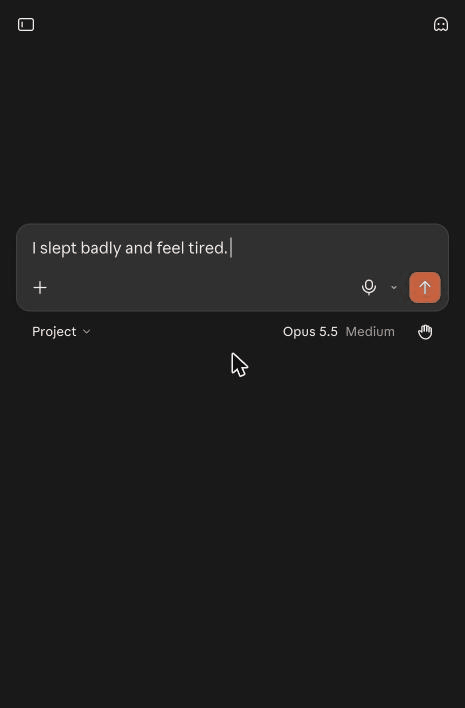
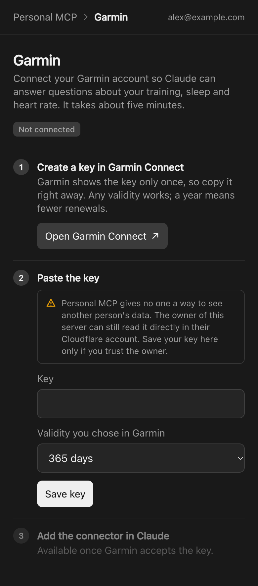
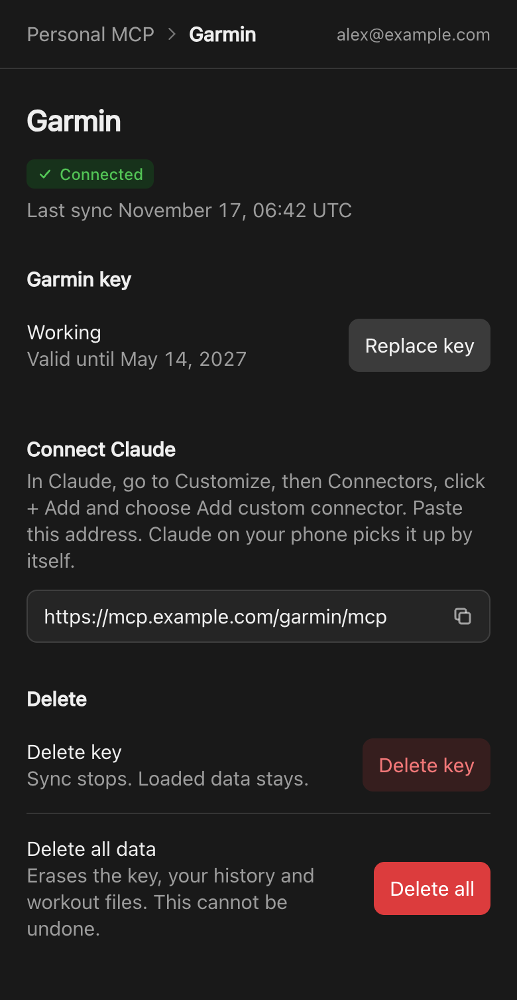
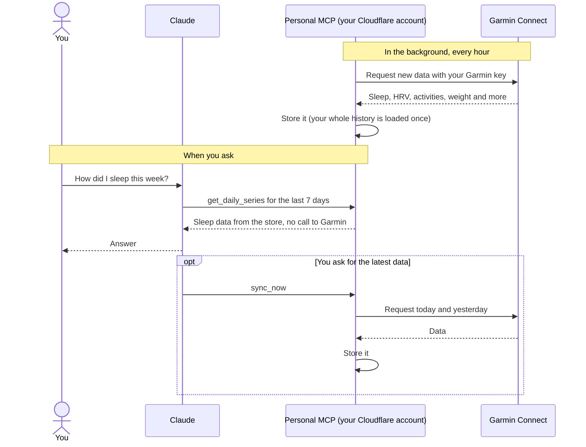

# Personal MCP

A multi-user Garmin MCP server on Cloudflare: minimal code, authorization by Cloudflare Access, sign-in with Google
or by email.

To install it, you need:

- A GitHub account (free).
- A Cloudflare account (free).
- A domain on Cloudflare. You can buy one through Cloudflare.
- A Google Cloud Console account (free), only if you want sign-in with Google.

Data from your watch that Claude can use:

- **Sleep:** duration, stages, sleep score and the sleep you need.
- **HRV:** last night, the weekly average and the HRV status.
- **Heart rate:** resting heart rate and readings through the day.
- **Weight:** weight, BMI, body fat, muscle mass and your weight goal.
- **Calories burned:** total and active calories each day, and the calories of each workout.
- **Workouts:** distance, pace, heart rate zones, splits, training load and VO2 max.
- **Other:** Body Battery, stress, steps, intensity minutes, SpO2, respiration, food log, hydration, menstrual
  cycle and fitness age.

You set it up once on the Cloudflare and GitHub websites, with nothing to install on your computer. Each person
connects in about five minutes and sees only their own data.

<p>
  
</p>

- **Any Claude app:** Claude Desktop, claude.ai, Claude on your phone or Claude Code.
- **Your whole history**, refreshed every hour, so Claude can compare last night with past years.

## How you use it

Each person connects one time:

1. Create a Garmin key in Garmin Connect.
2. Paste the Garmin key on the settings page.
3. Add the connector in Claude.

<p>
  
  
</p>

Then ask, for example: "Look at my last four weeks and suggest a plan for next week." Claude asks you to sign in
again about once a month. If Claude tells you that your Garmin key expires soon, replace it.

## Why not just use the Garmin API

Garmin's Personal API gives raw data to a program that you write and run. Personal MCP is that program:

| Garmin API alone | Personal MCP |
|---|---|
| Fetch most data one day or a few weeks at a time, and renew access every day | Your whole history, loaded once and refreshed every hour |
| Each question waits for Garmin and its limits | Claude reads a stored copy and is told when it is out of date |
| Store and search the raw data yourself | Tools for a day, trends over a year, activities and splits, plus read-only SQL |

It does not calculate its own training scores (CTL/ATL/TSB) or send plans to your watch. It never asks for your
Garmin password.

## Where your data lives

- **In your Cloudflare account:** one database per person, and activity files. Cloudflare encrypts both when it
  stores them. Personal MCP encrypts only the Garmin keys, and they never reach Claude.
- **Each person sees only their own data, you included.** Personal MCP has no tool or page that shows one person's
  data to another. The data is still in your Cloudflare account, and not opening it there is up to you.
- **It leaves only in answers to Claude.** Garmin is the only outside service it calls. Delete all on the
  settings page erases your key, history and files.

## What you need

Each person must have a Garmin Connect account and Claude with custom connectors. Besides the accounts at the top,
you must have:

- A host on your domain that nothing else uses, for example `mcp.example.com`.
- Cloudflare Zero Trust with the Free plan (up to 50 users). Its sign-in part is Cloudflare Access.
- R2, the file storage of Cloudflare. Do the checkout in Storage & databases → R2.

NOTE: The Zero Trust and R2 checkouts ask for payment details. The plans that Personal MCP uses are free.

## Install

An agent such as Claude Code can do most of [2. Deploy](#2-deploy), see
[Install with your agent](docs/install-with-agent.md). For a terminal, see
[Deploy from a terminal](docs/install-manual.md).

### 1. Access

Do steps 1 to 5 in Cloudflare Zero Trust.

1. In Integrations → Identity providers, add One-time PIN.

   Result: people get a sign-in code by email.

   To add Google later, see [Google sign-in](#google-sign-in).
2. Create an Email list with the email of each person who can sign in.
3. WARNING: Do not use Everyone or a login-method rule in the policy. The policy is the only admission check.

   Add a self-hosted Access application for your whole host, with no path. Set these values:
   - Login methods: One-time PIN.
   - Session duration: 1 month.
   - Policy: Allow, Include → Emails in list → your Email list.
4. In the settings of the Access application, set Managed OAuth to on. Set these values:
   - Redirect URIs: `https://claude.ai/api/mcp/auth_callback` (Claude Desktop, claude.ai and phone) and
     `http://localhost:48765/callback` (Claude Code).
   - Allow localhost clients and Allow loopback clients: off.
   - Grant session duration: 1 month. Access token lifetime: 15 minutes.
5. In Additional settings of the Access application, copy the Application Audience (AUD) Tag.

6. In the Cloudflare dashboard, find your account ID in Workers & Pages → Account Details.

CAUTION: Make sure that the changes in steps 7 and 8 are safe for your other hosts. They apply to the whole
domain.

7. For your domain, go to Security → Settings → Bot traffic. Set Bot Fight Mode to off.
8. On the same page, make sure that the AI crawler and agent policies do not block Claude.

### 2. Deploy

GitHub Actions deploys two Workers from your fork: the gateway Worker and the Garmin Worker.

WARNING: Put private values only in the four secrets. Your fork and its run logs are public.

1. On the GitHub page of this repository, click Fork → Create fork.
2. In your fork, open the Actions tab. If GitHub shows a button to let workflows run, click it.
3. Create a Cloudflare token:
   1. Open [Account API tokens](https://dash.cloudflare.com/?to=/:account/api-tokens). Click Create Token.
   2. Under Permission policies, open the Custom dropdown. Select Edit Cloudflare Workers.
   3. Type a name for the token. Set its scope to your account and to the zone (domain) of your host.
   4. Create the token. Copy it immediately. Cloudflare shows it only one time.
4. In your fork, go to Settings → Secrets and variables → Actions. Use New repository secret to add four
   secrets:

   | Name | Value |
   |---|---|
   | `CLOUDFLARE_API_TOKEN` | The token from step 3 |
   | `CLOUDFLARE_ACCOUNT_ID` | The account ID from step 1.6 (32 characters) |
   | `ACCESS_AUD` | The AUD tag from step 1.5 (64 characters) |
   | `MCP_HOST` | Your host, for example `mcp.example.com` |

5. CAUTION: Use only an unused host. The deploy attaches it to the gateway Worker. It replaces a plain DNS record on
   the host and does not ask you.

   Click Actions → Deploy → Run workflow → Run workflow.

Result: the run takes a few minutes. The first run makes the encryption key for Garmin keys. It is not
necessary to back up this key.

- If the run is green, go to [3. Connect](#3-connect).
- If the `test` job is red, run Deploy again later. If the job fails again, wait for a new version. Then sync the fork.
- If the `deploy` job is red, open its `Deploy to Cloudflare` step. Find the message in the tables below.

WARNING: Do not delete the Garmin Worker (`personal-mcp-garmin`). This deletes the data of all people. If a run
cannot find the `KEY_ENCRYPTION_KEY` secret, read
[Restore the encryption key](docs/install-manual.md#restore-the-encryption-key) before you change anything.

<details>
<summary>If the run is red: messages and what to do</summary>

| Message in the `Deploy to Cloudflare` step | What to do |
|---|---|
| `Missing secrets: …` | Add the secrets that the message shows (step 4). Run Deploy again |
| `CLOUDFLARE_ACCOUNT_ID must be 32 hexadecimal characters.` | Paste the account ID again in `CLOUDFLARE_ACCOUNT_ID`. Do not include spaces or quotation marks. Run Deploy again |
| `ACCESS_AUD must be 64 hexadecimal characters.` | Copy the AUD tag from the Access application again. Paste it in `ACCESS_AUD`. Run Deploy again |
| `MCP_HOST must be a host name with a dot, such as mcp.example.com.` | Put only the host in `MCP_HOST`, for example `mcp.example.com`. Run Deploy again |
| `Could not tell whether the Garmin Worker is installed.` | The token or the account ID is wrong, or the token cannot edit Workers. Make sure that `CLOUDFLARE_ACCOUNT_ID` is correct. Create the token again (step 3). Put it in `CLOUDFLARE_API_TOKEN`. Run Deploy again |
| `The Garmin Worker exists but has no KEY_ENCRYPTION_KEY secret.` | WARNING: Do not delete the Garmin Worker. Do not change anything yet. In the dashboard, make sure that the secret is not there. Then read [Restore the encryption key](docs/install-manual.md#restore-the-encryption-key) |
| `Deploying the Garmin Worker failed.` or `Deploying the Gateway Worker failed.` | Read the lines above the message. On a first installation, the usual cause is that you did not do the R2 checkout (see [What you need](#what-you-need)). If you did the R2 checkout, create the token again (step 3). The token probably cannot edit Workers |
| `Could not check your host through the Cloudflare API.` | The token cannot read this account, or Cloudflare had a temporary problem. Make sure that the token and the account ID are correct. Run Deploy again |
| `Your host is already a custom domain of another Worker. Choose an unused host.` | Put a different host in `MCP_HOST`, or remove the host from the other Worker. Run Deploy again |
| `Deployed, but the host does not answer correctly yet: …` | The host did not pass the check after 15 minutes. Find the cause in the next table. Do the steps for that cause. Run Deploy again |

The end of the last message gives the cause:

| Cause | What to do |
|---|---|
| `Your host or its certificate is not ready yet.` | Run Deploy again after a few minutes. If the problem continues, make sure that the DNS of the host is on Cloudflare |
| `Managed OAuth is off in your Access application.` | Set Managed OAuth to on (step 1.4) |
| `No Access application covers your host, or Bot Fight Mode challenged the request.` | If no Access application covers the host, add one for the whole host (step 1.3). If Bot Fight Mode is on, set it to off (step 1.7) |
| `Your Access application has a path. Change it to cover the whole host.` | Remove the path from the Access application (step 1.3) |
| `Unexpected answers from your host: …` | Open `https://<host>/garmin/mcp` in a browser. Make sure that the page asks you to sign in. If it does not, do the steps in [1. Access](#1-access) again. Run Deploy again |

</details>

### 3. Connect

Do these steps. The people that you invite do the same steps.

1. In Garmin Connect, create a
   [Personal API key](https://connect.garmin.com/app/settings/personalApiToken). This is your Garmin key.
2. Copy the Garmin key. Garmin shows it only one time.
3. Open `https://<host>/garmin/settings`. Sign in.

   If the page shows `Forbidden`, the `ACCESS_AUD` secret is wrong. Put the AUD tag from step 1.5
   in `ACCESS_AUD`. Run Deploy again.
4. Paste the Garmin key.
5. Select the validity that you selected in Garmin.
6. Click Save key.
7. Add the connector in Claude:
   - **Claude Desktop and claude.ai:** go to Customize → Connectors → + Add → Add custom connector. Paste
     `https://<host>/garmin/mcp`. Claude on your phone then gets the connector automatically.
   - **Team or Enterprise plan:** an Owner of your Claude organization adds the connector. Each member then
     connects it in Customize → Connectors.
   - **Claude Code:** run this command:

     ```bash
     claude mcp add -s user --transport http --callback-port 48765 garmin https://<host>/garmin/mcp
     ```

     Then run `/mcp`. Sign in.

Result: your history loads in the background, in a few hours or a few days. Recent days are available
immediately. The settings page shows the progress.

If Claude tells you that your Garmin key expires soon, create a new Garmin key. Then click Replace key on the
settings page.

## People

WARNING: Before a person connects, tell them these two facts:

- Personal MCP has no tool or page to read the data of another person. You also do not have one.
- Their data is in your Cloudflare account. You can always read it directly in the database if you want to.

CAUTION: Connect people one at a time. Start after your own history is complete. If two histories load on the
same day, the account uses all of its free daily writes. Then writes fail for all people until 00:00 UTC. After
that, the sync of a person starts again when the person uses Claude.

To add a person:

1. Add their email to the Email list.
2. Send them the URL `https://<host>/garmin/settings`. Tell them to do the steps in [3. Connect](#3-connect).
3. Wait until their history is complete. Then add the next person.

To remove a person:

1. If they want to delete their data, tell them to click Delete all on the settings page. After step 2, they
   cannot sign in.
2. Remove their email from the Email list.
3. In Zero Trust, remove the person from the users. Their sessions stop, and their seat becomes available.

Result: if they did not click Delete all, their data stays in your account. Their sync stops after 30 days.

## Google sign-in

Google sign-in uses a Google OAuth app. Until you publish the app, only its test users can sign in. The app
must have a home page and a privacy policy. Personal MCP shows them at `/about` and `/privacy` on your host.

1. In Zero Trust, add a second self-hosted Access application for `<host>/about` and `<host>/privacy`.
2. Give it one policy: Bypass → Everyone.

   Result: the Google reviewers see the two pages, not a sign-in page.
3. Add Google as an identity provider. Use
   [the Cloudflare guide](https://developers.cloudflare.com/cloudflare-one/integrations/identity-providers/google/).
4. On the Google consent screen, set these values:
   - App name: a neutral name.
   - Home page: `https://<host>/about`. Privacy policy: `https://<host>/privacy`.
   - Authorized domains: `cloudflareaccess.com` and your domain.
   - Logo: none. If you add a logo, Google must verify the app.
5. Publish the app.
6. Add Google to the login methods of the main Access application.

## Update

WARNING: Sync only the changes that you trust. Sync fork also copies changes to the workflow, and the workflow
has your Cloudflare token.

1. In your fork, click Sync fork → Update branch.

   Result: the deploy usually starts automatically.
2. If Actions does not show a new run after one minute, run Deploy manually.

To update from a terminal, see [Deploy from a terminal](docs/install-manual.md#update).

## Limits

- The Garmin Personal API is new. Garmin does not publish its limits, and they can change.
- The Garmin FAQ says that the Personal API is "not intended for commercial applications serving multiple end
  users". Personal MCP is for you and a few people, each with their own Garmin key. It is not commercial.
- Claude is the tested client. If you use a different MCP client, add its OAuth redirect URI to Managed OAuth.

## How it works



Cloudflare Access signs people in. The gateway Worker sends each request, with the verified email, to the
Garmin Worker.
[docs/architecture.md](docs/architecture.md) describes the sync, storage, encryption, the 13 MCP tools, the
[Free-plan limits](docs/architecture.md#platform-limits) and how to add a server.

## Develop

```bash
npm install
npm test
npm run typecheck
npm run dev
```

`npm run dev` serves all parts at `http://localhost:8787` as `alex@example.com`. The warning
`Missing required secrets: ACCESS_AUD` is normal. To save a Garmin key locally, add `KEY_ENCRYPTION_KEY` to
`workers/garmin/.dev.vars`. To make the encryption key, use the command in
[Deploy from a terminal](docs/install-manual.md#create-the-encryption-key).

## License

[MIT](LICENSE)
